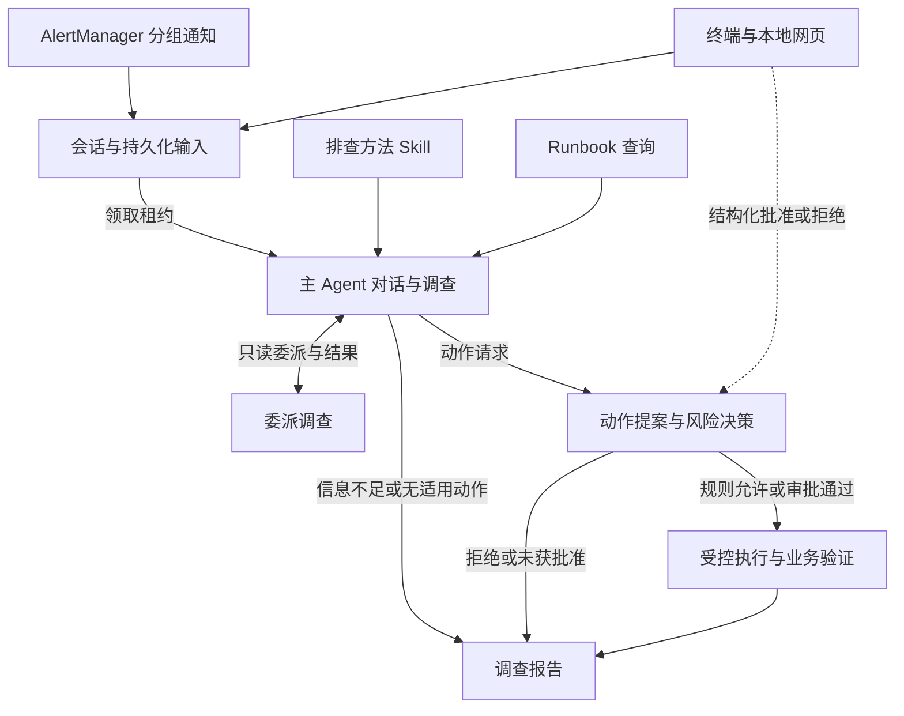

# Vigil 全局架构

交互终端、一次性 CLI 与本地 `serve` 共用 PostgreSQL 中的会话账本。持有会话租约的进程驱动主线，待审问题由独立只读旁路处理。

## 架构约束

- 配置用 Pydantic Settings，日志用 Loguru；脚本使用 shell 或 Python。
- 优先复用成熟依赖：LangGraph 负责编排、checkpoint 与审批恢复，LangChain `create_agent` 负责工具循环。
- 一个 PostgreSQL 实例承载业务表、checkpoint 与以后的知识向量。
- 只用现有模型网关的 OpenAI 兼容端点。
- 不导入、不读取 `deprecated/` 中的旧项目。

## 全局流程

Agent 选择查询、整理证据并提出动作。执行器根据固化卡片、授权、会话租约和目标锁确定是否取得发送权。发送后的验证由原尝试独立收尾。CLI 与网页从相同序号读取脱敏事件，接手时继续保存的轮次。

## 模块边界与依赖

| 模块 | 源码入口 | 依赖与职责边界 |
|---|---|---|
| 接入 | [cli.py](src/aiops/cli.py)、[serve.py](src/aiops/serve.py)、[web_api.py](src/aiops/web_api.py)、[webhook.py](src/aiops/webhook.py) | 终端、FastAPI 本机网页和 Starlette 告警监听，通过 factory 装配会话 |
| 会话账本 | [sessions/](src/aiops/sessions) | 会话、输入、序号、主旁路租约、原子 checkpoint 投递及共享出站投影 |
| 调查 | [agent/](src/aiops/agent)、[factory.py](src/aiops/investigation/factory.py) | 编排模型、预算、假设、证据与终态；依赖工具、Store 和动作执行器 |
| 排查能力 | [skills.py](src/aiops/skills.py)、[registry.py](src/aiops/tools/registry.py)、[toolbox.py](src/aiops/investigation/toolbox.py) | 装配 Skill 与工具；委派共享预算和观测，只有只读能力 |
| 受控处置 | [actions/](src/aiops/actions) | 风险规则、授权、资源快照、锁、外部写入与业务验证；不以模型结论代替授权 |
| 持久化与审计 | [db.py](src/aiops/db.py)、[contracts.py](src/aiops/contracts.py)、[migrations/](src/aiops/migrations) | 业务状态与约束；checkpoint 由官方 saver 管理，追踪平台不参与业务正确性 |
| 运行手册知识 | [knowledge.py](src/aiops/knowledge.py) | 结构化 runbook 导入与查询，通过 Store 与工具供调查参考 |
| 值班面板 | [monitoring/](src/aiops/monitoring) | 读取 Prometheus、Kubernetes 和已核实动作，生成本地快照和发布指标 |

运行状态与诊断结果独立记录：任务结束不等于查明根因，动作执行不等于业务恢复。业务数据结构和枚举定义在 `contracts.py`，数据库约束定义在 `migrations/`。

FastAPI 在回环监听同源提供 React 页面、静态资源和会话 API。首页和会话深链接有显式
路由。两套 ASGI 应用共用请求体上限与错误响应。网页中间件和一次性登录负责本机
Host、浏览器来源及写操作凭证的校验。告警监听使用独立的地址和 Bearer 令牌，
`serve` 统一处理两个监听的生命周期。

## 后续扩展边界

以下是为后续能力预留的接口方向，当前没有实现：

| 方向 | 约定 |
|---|---|
| Loki、Tempo 工具 | 注册为只读工具：Loki 用 LogQL、时间窗和游标，保留原查询，不整段倒给模型；Tempo 区分搜索摘要和 trace 详情 |
| 知识检索 | 输入查询、服务、文档范围和条数，输出条目类型、内容、来源、页码、版本和检索分数 |
| 历史事故 | 保存症状、根因、解决方法、证据和确认状态；未经验证的结论不能自动变成可信知识 |
| 文本 PDF | 保存文档 ID、哈希、版本、页码和 chunk；导入可重复，更新替换旧版本，删除后不再召回；扫描件和复杂版式明确拒绝。embedding 模型、维度和距离属于索引约定，换模型要重建 |
