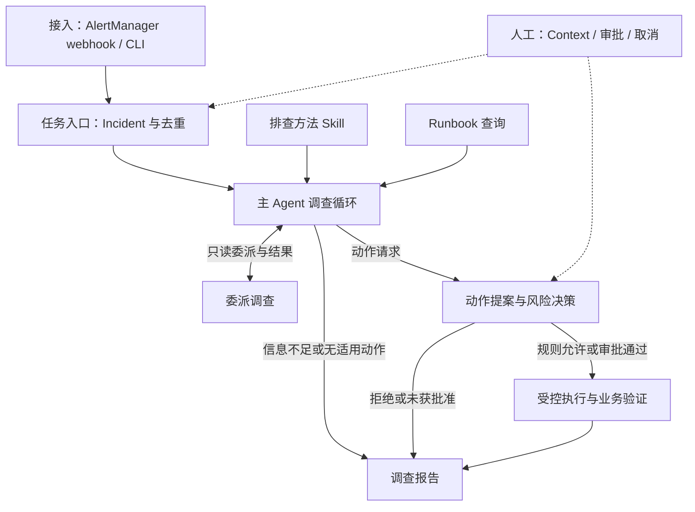

# Vigil 全局架构

Vigil 在同一进程内组织接入、调查与受控处置。

## 架构约束

- 配置用 Pydantic Settings，日志用 Loguru；脚本使用 shell 或 Python。
- 优先复用成熟依赖：LangGraph 负责编排、checkpoint 与审批恢复，LangChain `create_agent` 负责工具循环。
- 一个 PostgreSQL 实例承载业务表、checkpoint 与以后的知识向量。
- 只用现有模型网关的 OpenAI 兼容端点。
- 不导入、不读取 `deprecated/` 中的旧项目。

## 全局流程

设计的核心分工：**调查交给 Agent，处置交给程序。** Agent 决定查什么、怎样解释、提出什么动作；动作能否执行、怎样执行、算不算恢复，由确定性的代码判断。Agent 调查中的写操作只经过 `request_action` 一个入口，Skill 和委派调查都不能绕开它。所有模块在同一进程内，不拆分服务。

## 模块边界与依赖

| 模块 | 源码入口 | 依赖与职责边界 |
|---|---|---|
| 接入与操作 | [cli.py](src/aiops/cli.py)、[webhook.py](src/aiops/webhook.py) | 校验输入、鉴权、去重和命令输出；通过 factory 装配调查或操作者执行器 |
| 调查 | [agent/](src/aiops/agent)、[factory.py](src/aiops/investigation/factory.py) | 编排模型、预算、假设、证据与终态；依赖工具、Store 和动作执行器 |
| 排查能力 | [skills.py](src/aiops/skills.py)、[registry.py](src/aiops/tools/registry.py)、[toolbox.py](src/aiops/investigation/toolbox.py) | 装配 Skill 与工具；委派共享预算和观测，只有只读能力 |
| 受控处置 | [actions/](src/aiops/actions) | 风险规则、授权、资源快照、锁、外部写入与业务验证；不以模型结论代替授权 |
| 持久化与审计 | [db.py](src/aiops/db.py)、[contracts.py](src/aiops/contracts.py)、[migrations/](src/aiops/migrations) | 业务状态与约束；checkpoint 由官方 saver 管理，追踪平台不参与业务正确性 |
| 运行手册知识 | [knowledge.py](src/aiops/knowledge.py) | 结构化 runbook 导入与查询，通过 Store 与工具供调查参考 |
| 对照评估 | [evaluation/](src/aiops/evaluation)、[rules.py](src/aiops/investigation/rules.py) | 场景动词编排、判定口径、规则基线与汇总；故障机制仍在 `faults/`，评估不直接改集群 |

运行状态与诊断结果独立记录：任务结束不等于查明根因，动作执行不等于业务恢复。业务数据结构和枚举定义在 `contracts.py`，数据库约束定义在 `migrations/`。

## 后续扩展边界

以下是为后续能力预留的接口方向，当前没有实现：

| 方向 | 约定 |
|---|---|
| Loki、Tempo 工具 | 注册为只读工具：Loki 用 LogQL、时间窗和游标，保留原查询，不整段倒给模型；Tempo 区分搜索摘要和 trace 详情 |
| 知识检索 | 输入查询、服务、文档范围和条数，输出条目类型、内容、来源、页码、版本和检索分数 |
| 历史事故 | 保存症状、根因、解决方法、证据和确认状态；未经验证的结论不能自动变成可信知识 |
| 文本 PDF | 保存文档 ID、哈希、版本、页码和 chunk；导入可重复，更新替换旧版本，删除后不再召回；扫描件和复杂版式明确拒绝。embedding 模型、维度和距离属于索引约定，换模型要重建 |
| 执行中断协调 | 重启后根据持久化的执行意图核实真实资源状态，能核实的收敛，不能核实的保持未知并升级 |
| 外部通用 Agent 对照 | 同一故障集与同一权限，只换执行体；需要外部 Agent CLI 与独立预算评估 |
