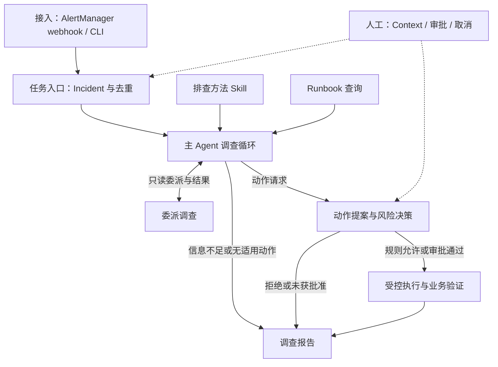
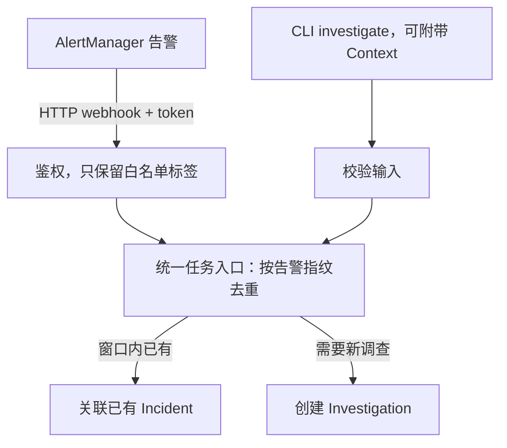
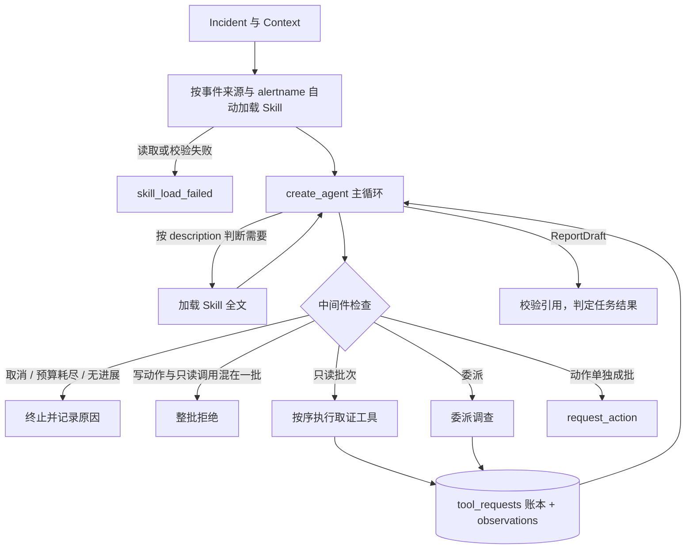
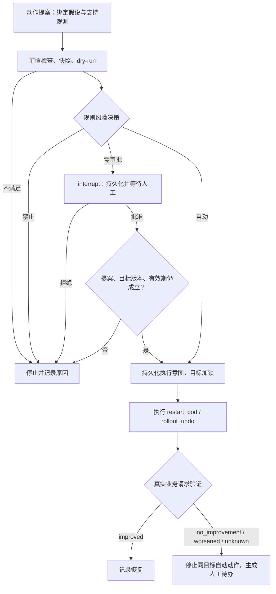

# Vigil 设计文档

本文说明 Vigil 要解决什么问题、整体怎样设计、各模块怎样工作，以及实现必须遵守的规则。单项决策的背景和备选方案见 [ADR](adr/)，进度与验收见[路线图](ROADMAP.md)，术语见[词汇表](../GLOSSARY.md)，操作方法见[操作手册](USAGE.md)。字段与枚举的权威定义在代码里：[contracts.py](../src/aiops/contracts.py) 与 [迁移文件](../src/aiops/migrations/)。

## 1. 背景与目标

中小企业和个人开发者通常没有专职 SRE。Kubernetes 上的服务出故障时，排查往往要依赖少数熟悉系统的人，处置也容易凭经验直接改集群。

Vigil 的目标：

1. 告警或手动请求进来后，Agent 在有界预算内取证，提出有依据的根因候选，或者如实说明信息不足。
2. 处置只用少量受控动作，由规则或人工授权，执行后用真实业务请求验证。
3. 每次判断和操作都能回查：查了什么、发现了什么、依据哪个假设、谁授权、改了什么、结果如何。
4. 排查方法可以通过增加 Skill 来扩充，不必修改主循环代码。

## 2. 非目标

- 不修改代码、业务数据或任意配置；动作范围见 [ADR-0004](adr/0004-controlled-resource-actions.md)。
- 不承诺任意故障都能自愈，也不承诺跨动作事务或业务数据回滚。
- 单机实验环境不证明生产可用、高可用、企业权限治理或总体准确率。
- 当前不提供前端、持续对话和对外查询 API；它们排在[路线图](ROADMAP.md#后续能力)的后续能力中。

## 3. 约束

- Linux + uv，Python；配置用 Pydantic Settings，日志用 Loguru。
- 优先复用成熟依赖：LangGraph 负责编排、checkpoint 与审批恢复（[ADR-0002](adr/0002-langgraph-orchestration.md)），LangChain `create_agent` 负责工具循环（[ADR-0005](adr/0005-langchain-single-agent-loop.md)）。
- 一个 PostgreSQL 实例承载业务表、checkpoint 与以后的知识向量（[ADR-0003](adr/0003-postgres-pgvector.md)）。
- 只用现有模型网关的 OpenAI 兼容端点（[ADR-0010](adr/0010-model-gateway.md)）。
- 不导入、不读取 `deprecated/` 中的旧项目（[ADR-0001](adr/0001-isolate-legacy-project.md)）。

## 4. 总体设计

设计的核心分工：**调查交给 Agent，处置交给程序。** Agent 决定查什么、怎样解释、提出什么动作；动作能否执行、怎样执行、算不算恢复，由确定性的代码判断。Agent 调查中的写操作只经过 `request_action` 一个入口，Skill 和委派调查都不能绕开它。所有模块在同一进程内，不拆分服务。

关键决策：

| 决策 | 选择 | ADR |
|---|---|---|
| 调查运行时 | `create_agent` 加 Skill、工具注册表和只读委派调查 | [ADR-0007](adr/0007-skill-tool-subagent-runtime.md) |
| 任务状态 | 运行状态与诊断结果分开记录 | [ADR-0006](adr/0006-task-outcome-separation.md) |
| 范围与故障集 | 实验环境、遥测和场景范围 | [ADR-0008](adr/0008-product-scope-and-lab.md) |
| 风险与验证 | 规则分级、业务请求验证、异常停止 | [ADR-0009](adr/0009-risk-verification-and-stop.md) |
| 预算 | 工具 28、模型 20、墙钟 600 秒 | [ADR-0011](adr/0011-investigation-budget.md) |

## 5. 详细设计

### 5.1 接入

- webhook 和 CLI 只负责转换与鉴权，之后进入同一个任务入口。
- webhook 只保留调查需要的标签（`alertname`、`namespace`、`service` 等），`scenario` 这类实验标记会被丢弃。
- 同一告警指纹在 `VIGIL_DEDUP_MINUTES` 内只建一次事件。同一事件可以有多次调查，每次调查独立记录。
- 告警只触发调查，不授权写操作。
- `context` 在启动时入库。它是人的陈述，需要核实，不能当作工具证据或执行授权。

### 5.2 调查循环

中间件负责三件横切的事：

- **动作批次**：写动作必须独占一次模型响应，混入只读调用时整批拒绝；业务恢复后拒绝新的写操作。
- **预算**：模型和工具请求发出前先扣预算，取消、超时和失败也计入用量。每次模型调用按剩余时间限时，只对瞬态错误有限重试。预算分为调查和动作两段；写操作前必须预留适配器的完整时间上界和至少一次反馈模型调用，不够就不开始写。
- **进展**：没有新观测、也没有改变任何假设状态的轮次不算进展，重复执行同一个读取请求也不算。累计 3 轮后停止。

终态报告由 `ToolStrategy(ReportDraft)` 约束结构。客户端校验三件事：引用的假设和观测都存在，假设状态与支持关系一致，根因未确认时列出候选假设。结构错误只允许纠正 1 次。

同一调查的工具按批次顺序串行执行，不并行调度。工具调用 ID 由运行时生成为 `"<investigation_id>:<tool_call_id>"`，避免不同调查的模型调用 ID 冲突。

### 5.3 假设与证据

- 假设只保存陈述、状态、可选父假设和更新理由，不维护完整假设树和修订历史。状态为 pending、supported、refuted、inconclusive；`supported` 表示当前证据支持，不表示已被证明。
- 一次工具调用最多产生一条观测，唯一约束为 `(investigation_id, tool_call_id)`。观测区分 ok、empty、error，并记录截断标记、时间窗和原始结果引用。
- 证据是观测与假设之间的关系，取值 supporting、refuting、neutral，唯一约束为 `(hypothesis_id, observation_id)`。只有 status 为 ok 的观测能标为 supporting 或 refuting；知识条目不能作为证据。多个假设引用同一条观测时共用这条记录，避免重复统计。
- 大的原始结果存在 `runtime/` 下的文件中，业务表保存引用、哈希与尺寸。只备份数据库不等于完整备份证据。

### 5.4 排查方法（Skill）

Skill 采用 [Agent Skills 规范](https://agentskills.io/specification)。每个 Skill 是 `skills/<name>/` 下的一个目录，包含带 YAML 元数据的 `SKILL.md`，可以附带参考材料。当前只从仓库内置目录加载，加载接口允许以后增加其他来源。

| 元数据 | 约定 |
|---|---|
| `name` | 符合规范，与目录名一致 |
| `description` | 说明做什么、何时使用，供描述触发 |
| `metadata.vigil-auto-load-sources` | 可选，空格分隔的事件来源：`alert`、`manual`、`scheduled` |
| `metadata.vigil-auto-load-alertnames` | 可选，空格分隔的告警 `alertname` |

- 规范要求 `metadata` 的值是字符串，所以列表用空格分隔；`vigil-` 前缀之外的字段不影响加载。
- **信号触发**：调查开始时，程序把事件来源和告警 alertname 与上面两个字段比对，命中就把全文注入调查，不经过模型。读取或校验失败时以 `skill_load_failed` 停止。
- **描述触发**：模型根据 `description` 决定是否读取全文。
- `hypothesis-driven-investigation` 绑定 `alert manual scheduled` 三种来源。
- 两种方式加载的 Skill 都以名称、内容哈希和触发方式记录在调查上。
- Skill 是调查做法，不是证据或授权，不能放宽工具权限、风险规则或动作证据要求。

### 5.5 工具

- 工具通过与环境无关的注册表装配，每个工具声明名称、输入输出模型、只读或写入属性和所需提供方。注册接口不依赖 Kubernetes 类型。
- 当前提供：Kubernetes 与 Prometheus 的只读查询、runbook 查询、`manage_hypotheses`、`assess_evidence`、`request_action`。
- Kubernetes 只开放白名单内的读取操作，上下文固定，不接受任意 shell；Prometheus 限制点数和响应字节。
- 401、403 和非法参数不自动重试；429 和瞬态超时在截止时间内有界重试。
- 工具返回的原始内容可能含有提示词注入，一律按数据处理，不能据此改变工具权限或风险规则。
- 场景真值不在任何工具的可读范围内。Skill 文件只能从 `skills/` 目录读取。

### 5.6 委派调查

- 主 Agent 通过 `task` 工具提交目标。委派调查在独立上下文中只用只读工具取证，返回结果摘要和产生的观测。
- 同一调查同时最多一个委派调查运行，主 Agent 等待它返回。委派调查与主调查共享同一份预算、集群与命名空间范围。
- 委派产生的观测写入同一张表，带 `delegation_id`。主 Agent 可以把它们作为证据和动作依据，校验规则与自己的观测相同。
- 委派调查拿不到 `request_action` 和任何写入工具；如果调用了，立即以 `read_only_violation` 终止，并写审计事件。
- 单次委派失败只把错误返回给主 Agent；同一调查第 2 次失败时以 `delegation_failed` 终止。

### 5.7 动作请求与风险决策

**动作依据**

- Agent 通过 `request_action` 提出的动作，必须引用一个已存在的假设，以及至少一条已判定为支持该假设的观测（主 Agent 或委派调查产生的都可以）。假设必须是对异常原因的可验证解释，不能是“用户要求执行某动作”这样的请求本身。
- 这条引用要求由 Agent 工具路径的程序校验，并写在 `request_action` 的工具说明中，与是否加载了 Skill 无关。校验失败时，错误作为工具结果返回给模型，并计入预算；连续 2 次失败时以 `ungrounded_action` 终止。CLI `act` 直接调用执行器，不执行这项假设与支持观测引用校验；它仍须经过执行器已有的授权与写前检查。
- `request_action` 只接受 `restart_pod` 与 `rollout_undo`。`purpose=diagnostic` 时必须同时给出预测、预测不成立的含义和业务目标；观察窗有服务端下限，模型不能缩短。
- 出现持续 OOM 时，`restart_pod` 判为不适用：历史模板的内存与当前不同且已经 OOMKilled，或者 OOMKilled 且重启次数不少于 2。程序也不会通过修改内存规格来“修复”。

**风险决策**

- 先判硬约束：命名空间白名单、动作注册表、证据有效性、并发冲突、资源身份与版本、适用性。不满足就拒绝或升级。之后才按风险维度分级（[ADR-0009](adr/0009-risk-verification-and-stop.md)）。不采信模型自报的置信度。
- 当前唯一的自动允许规则：`restart_pod` 的目标在 `vigil-experiment` 中，Pod 带 `vigil.io/discardable=true`，有 ReplicaSet 归属，并有验证 Service。命中后策略以 `policy:<策略版本>` 记一条授权，执行仍然走锁、复查、dry-run 与业务验证。其他动作都需要人工审批，不在白名单中的命名空间一律拒绝。
- 自动执行前，要确认验证 Service 已经选中目标 Pod（包括 NotReady 地址）。
- **停止门**：同一集群、同一工作负载上次动作没有成功结束时（失败、未知、执行中，或已授权但未执行），后续提案一律转人工。待审批、策略拒绝、人工拒绝和授权过期都不会解除这个状态，只有一次成功执行才会。

**审批**

- 审批在 `request_action` 工具内部用 `interrupt()` 暂停，人的决定通过 `Command(resume=...)` 回到同一张图。
- 恢复时 LangGraph 会从工具开头重跑。所以工具先写 `tool_requests` 账本再执行，重放命中终态时直接返回保存的结果，不会第二次写集群。
- 审批绑定提案摘要哈希、目标 UID 与 resourceVersion，以及有效期。过期、参数改变或资源漂移时必须重新评估，不沿用旧授权。

### 5.8 执行与验证

- 动作适配器的接口是 `preconditions / dry_run / execute / verify / undo`，并显式声明可逆性、前置快照和补偿条件。不可逆动作的 `undo` 返回 unsupported，不能用空实现报告恢复成功。资源快照与 LangGraph checkpoint 是两回事。
- 同一目标互斥执行。先在数据库中持久化执行意图和幂等键，再发外部请求。请求发出后进程崩溃时，先核实真实状态，不直接重放写操作；当前做法是把结果记为未知并停止，等待人工核实。
- 动作前先采集业务基线，采不到基线就不写集群。基线等待结束后、写请求发出前，重新核对目标 UID、模板、可丢弃标记、Service 选择关系、停止门和授权有效期，任何一项变化都不发写请求。
- **有效样本**：
  - 重启路径直接请求 Pod 代理。鉴权、代理和网关错误没有取得业务响应，不算业务失败样本；非有限的遥测值也不计入。
  - 回退路径使用 `probe_http_status_code`，0、401、403、502、503、504 不计入有效样本，其余非 2xx 算业务失败。探测传输失败不冒充业务失败。
- **结果分类**：取值 improved、no_improvement、worsened、unknown。分类与恢复判定用同一个末段窗口，预热期的失败不计入恶化。
  - 基线没有失败而末段出现失败，或者末段失败率上升达到 0.5，记为 worsened；
  - 末段仍然失败但没有达到该阈值，记为 no_improvement；
  - 有效样本不足或无法比较，记为 unknown。
  - 业务恢复了，但模板、Service 或就绪检查没有通过，记为 `outcome=unknown`，提案状态为 `failed`。
- 无流量、no data、遥测过期都不算健康；只有 Pod Ready 也不算恢复。
- 结果为 no_improvement、worsened 或 unknown 时，在同一事务里写入 `action_followups` 人工待办。写之前就失败的请求不建执行记录，也不建待办。解决待办必须提供操作者和说明，并写审计事件 `action.followup_resolved`。
- `restart_pod` 删除指定 Pod，观察控制器重建，按 UID 变化与模板不变来核实，不能用会新增 revision 的 `rollout restart` 代替。删除只用 UID 作前置条件：Pod 的 `resourceVersion` 随状态更新不断变化，绑定它会让删除在读取后几毫秒内冲突。
- `rollout_undo` 必须校验已验证健康的历史模板和当前目标版本，镜像或模板的恢复与业务恢复分开记录。
- 补偿只恢复声明的字段，并检测并发的人工修改，不盲目回写整个旧对象；只做单动作补偿。自动补偿属于后续能力。

### 5.9 任务状态与终止

- `investigations.status` 只表示诊断结果。运行状态放在 `investigation_tasks` 和 CLI 输出的 `data.task` 中（[ADR-0006](adr/0006-task-outcome-separation.md)）。
- 数据库约束保证：终态必须有 outcome 与 termination_code，等待审批必须绑定提案，非终态不能有 outcome。
- 终止代码是稳定契约，取值见 [`TerminationCode`](../src/aiops/contracts.py)。新增代码要同步本文、CLI 与测试，不能临时用错误字符串代替。
- 业务恢复单独记录 `recovered_at`。报告里写了“已恢复”不算恢复证据，恢复由执行器的业务与平台断言判定。

### 5.10 持久化与审计

| 部分 | 内容 |
|---|---|
| 业务表 | 事件、调查（含 Skill 名称与哈希）、任务状态、工具账本、观测、假设与证据关系、委派调查、提案、审批、执行、目标锁、人工待办、Runbook、业务审计事件 |
| LangGraph checkpoint | 消息与图状态，由官方 saver 管理；项目不另存消息 |
| 原始观测文件 | `runtime/` 下的大结果，业务表保存引用、哈希与尺寸 |
| 可选追踪平台 | 提示词、模型输入输出、token、耗时、委派调查的内部步骤；默认关闭 |

- 判断规则：运行时需要读取的数据，以及需要长期保存的操作记录，放业务库；只用于人工排错和成本分析的数据，交给追踪平台（LangSmith 或 Langfuse）。恢复、去重、证据校验和审计都不读取追踪数据。
- `audit_events` 只追加写，只记录业务事件：告警接收、审批、取消、执行结果和待办处理。它不代替业务状态，也不记录 Agent 的每一步。
- checkpoint 只保存流程进度，不是 Kubernetes 资源快照，也不撤销外部副作用。checkpoint 使用官方 saver 自带的连接管理，不能用 SQLAlchemy AsyncEngine 代替 psycopg 连接。
- 业务表迁移在 `src/aiops/migrations/`，checkpoint 表由 saver 自行管理，两者分开。
- 通用规则：
  - ID 不含业务秘密；时间使用带时区的 ISO 8601，存储统一用 UTC。
  - 输入 schema 拒绝未知字段；凭据不进入 JSON、日志或报告。
  - 调查结论、动作适用性、授权、执行状态、业务恢复、人工待办和复位分开记录，不用一个 success 字段概括。

### 5.11 知识

- 当前提供少量结构化 runbook，可查询并引用来源，不依赖向量索引。Runbook 保存适用条件、步骤和工具映射；其中的动作建议仍要经过风险规则。
- Runbook 只是待核实的参考，不能作为证据，也不能包含实验场景的答案。

### 5.12 CLI

- 命令清单以 `aiops --help` 为准，用法见[操作手册](USAGE.md#4-命令手册)。
- `approve`、`reject`、`resume` 针对具体提案，驱动原任务的图继续执行；命令不能绕过风险规则。
- `cancel` 持久化取消请求：等待审批时直接终止，运行中则在下一个检查点生效。
- `serve` 只承担 webhook。
- 不为未实现的能力提供占位命令。
- JSON 输出包含 `schema_version`、`status`、`incident_id`、`investigation_id`、`action_id`、`data`、`error`。`data.task` 包含阶段、结果、终止代码、运行时版本、提案和用量；`data` 中还有所用 Skill 与委派调查摘要。
- 退出码：
  - 0：业务恢复，或仅完成诊断（包括异步 accepted，它不代表调查或修复成功）；
  - 1：运行失败；
  - 2：参数或用法错误（保留 Typer 的约定）；
  - 3：等待人工，或需要人工跟进；
  - 4：策略拒绝；
  - 5：信息不足。

## 6. 风险与已知限制

- 日志、指标、trace 可能同源相关，来源数量不能证明因果。缺少信号时标为证据缺口，不能编造。
- OOMKilled 应从容器终止状态读取，不能假设一定有同名 Event；持续 OOM 靠重建 Pod 解决不了。
- `restart_pod` 是删除加控制器重建，无法恢复原 Pod，按不可逆动作约束。
- server dry-run 只校验 API 请求与准入，预测不了调度或业务健康。
- Pod 重建场景下，模型常在凑齐动作依据之前就耗尽工具预算，因为平台工具读不到容器内部状态。见[运行记录](../faults/a01-pod-rebuild/runs/2026-11-13.md#连续失败的根因)。

## 7. 未决问题

- **风险维度的权重与阈值**：目前只有硬约束和唯一一条自动允许规则，分级评分尚未定义。
- **人工提示、对话消息与评估运行记录**：数据模型尚未定义，随对话与对照评估能力一起设计。

## 8. 后续扩展点

以下是为后续能力预留的接口方向，当前没有实现：

| 方向 | 约定 |
|---|---|
| Loki、Tempo 工具 | 注册为只读工具：Loki 用 LogQL、时间窗和游标，保留原查询，不整段倒给模型；Tempo 区分搜索摘要和 trace 详情 |
| 知识检索 | 输入查询、服务、文档范围和条数，输出条目类型、内容、来源、页码、版本和检索分数 |
| 历史事故 | 保存症状、根因、解决方法、证据和确认状态；未经验证的结论不能自动变成可信知识 |
| 文本 PDF | 保存文档 ID、哈希、版本、页码和 chunk；导入可重复，更新替换旧版本，删除后不再召回；扫描件和复杂版式明确拒绝。embedding 模型、维度和距离属于索引约定，换模型要重建 |
| 执行中断协调 | 重启后根据持久化的执行意图核实真实资源状态，能核实的收敛，不能核实的保持未知并升级 |
