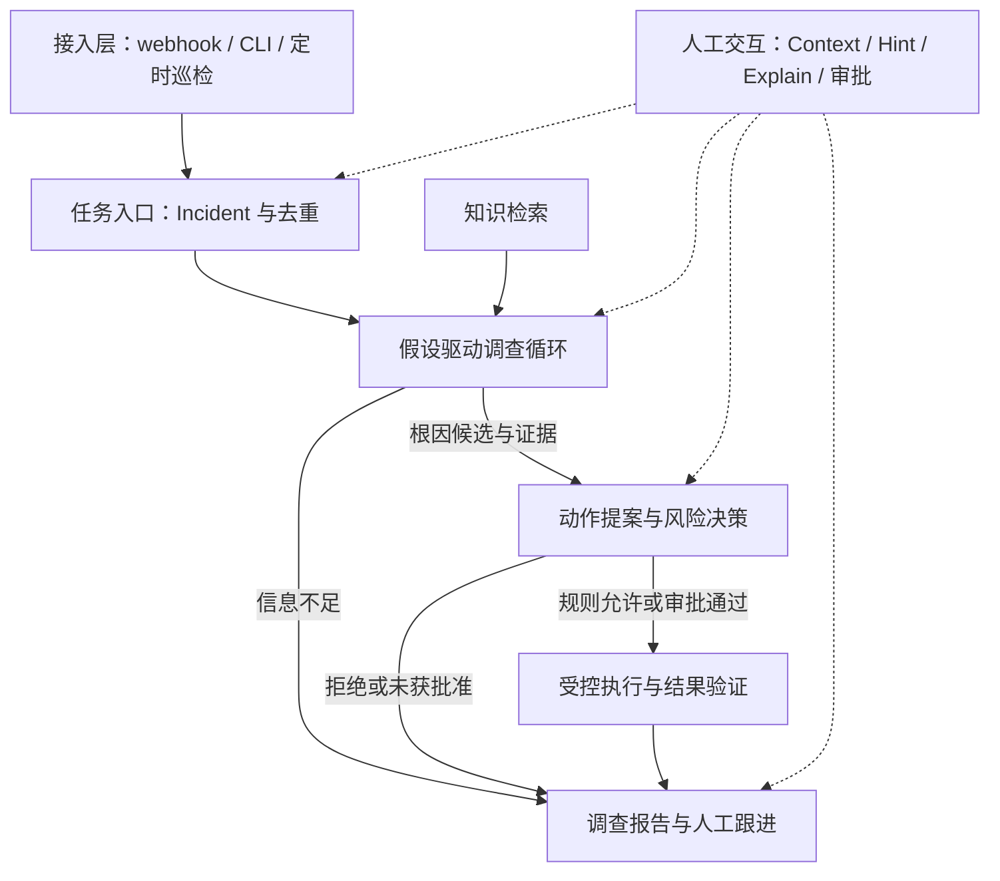
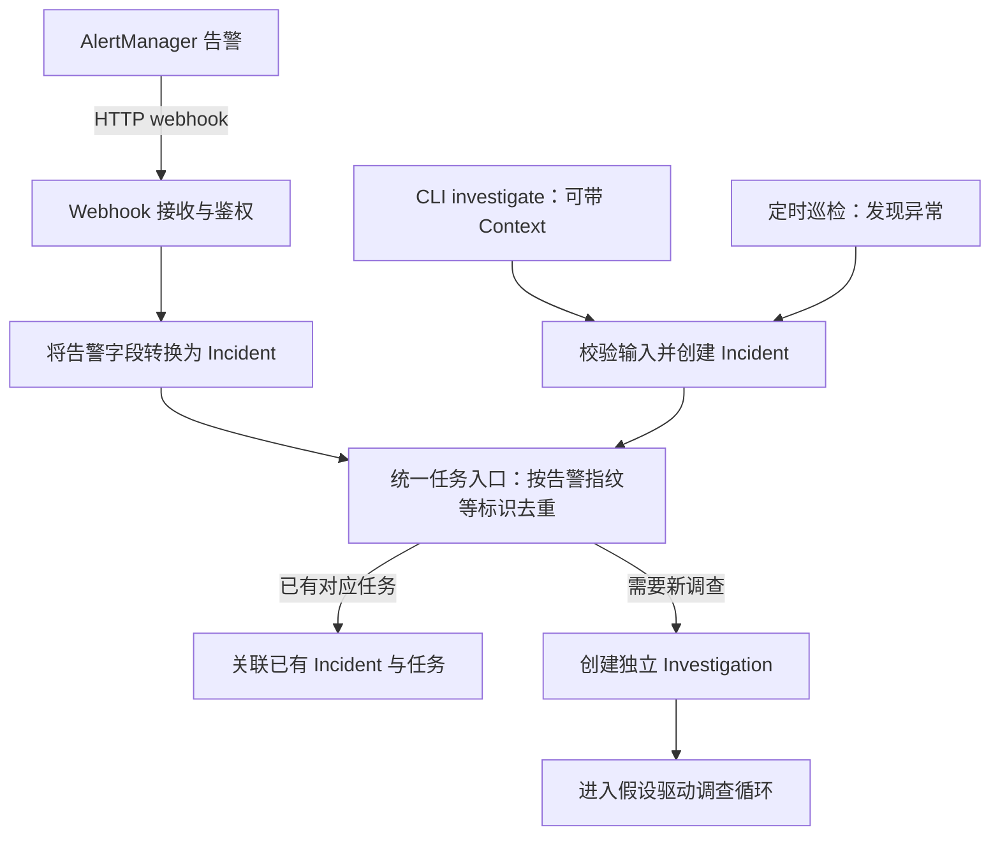
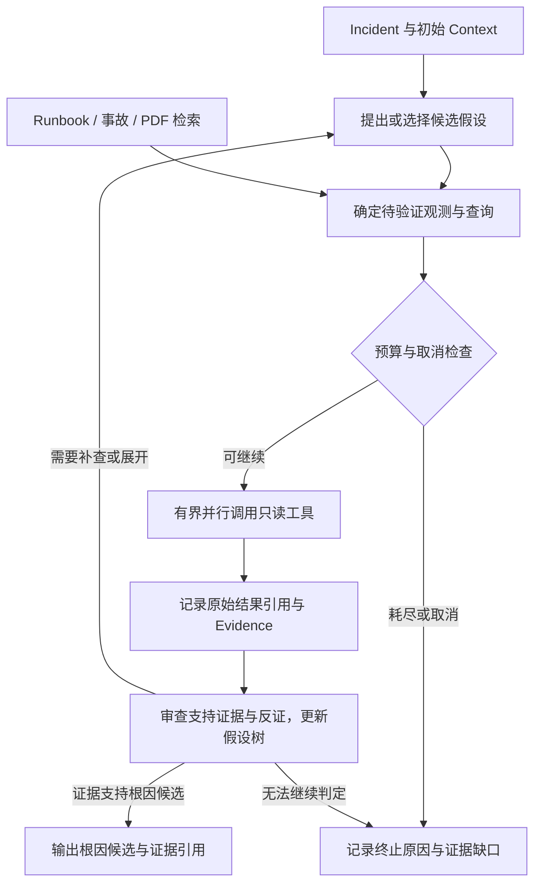
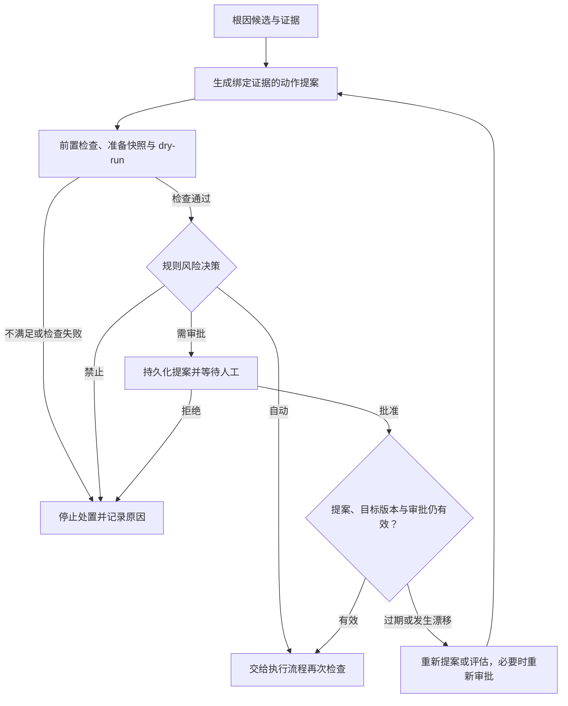
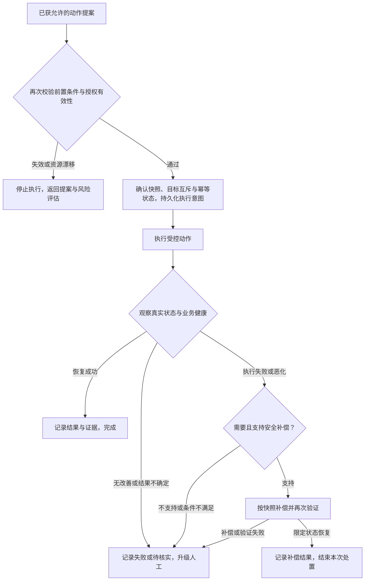
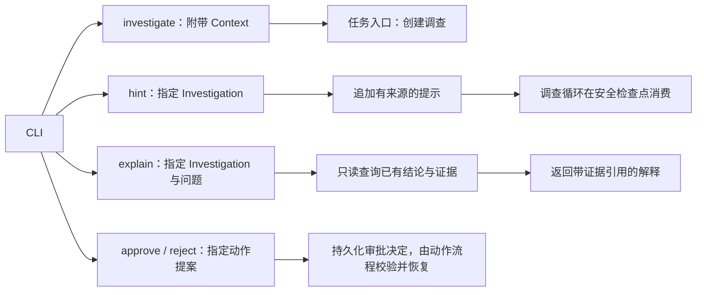
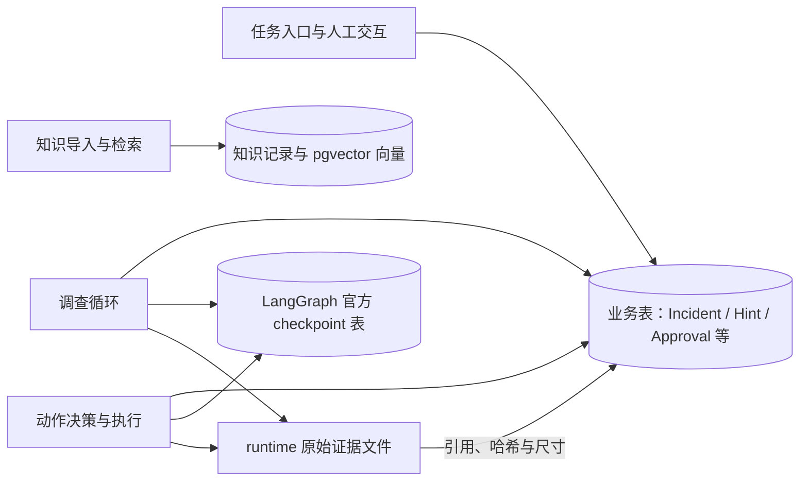

# Vigil AIOps 架构

状态：W0 骨架；调查与处置功能尚未实现。本文描述目标架构；已有选择及待确认细节见 [决策记录](decisions.md)，关键取舍见 [ADR 索引](README.md#架构决策记录)，领域术语见 [词汇表](../GLOSSARY.md)。

## 产品目标

提供事件驱动的故障调查、风险分级处置、执行后验证和有边界的自动补偿；CLI、外部 Agent 的 skill 与后台触发共享同一业务入口。面试作品必须提供可复现证据，而非用功能清单替代效果验证。

对话中“L5”表示本项目的受控自动处置目标，不代表行业认证或全场景自治。AIOps 不要求必须使用 Agent、假设树或自动写操作。通用 Harness 也能接入触发器、记忆、策略与 eval；本项目须用集成体验、恢复能力和评估证明专用服务的收益，不能以“skill 做不到”作为依据。

## 用户已确认的范围

| 领域 | 决定 |
|---|---|
| 迁移 | 旧代码、锁文件、配置及 Windows 脚本整体进入 `deprecated/`；新项目独立，不原地重构 |
| 平台 | Linux、shell/Python、uv；优先成熟轻量依赖，避免自建通用运行时 |
| 环境 | 宿主机运行 AIOps，独立 k3d 运行业务；MVP 真实浏览、加购、购物车路径，补齐 currency、shipping 等必要依赖；完整下单后置 |
| 遥测 | Prometheus + AlertManager + Loki + Tempo；配套采集器按实际接入需要配置 |
| 故障 | 四类共 12 场景；Python inject/verify/cleanup；首切片为坏发布回退，MVP 场景机制见 [场景卡](mvp.md#5-场景卡) |
| 框架 | LangGraph 已明确选择；未确认替换为纯 Python 调查 runner |
| 调查 | 显式假设树、结构化证据、可审计验证；固定主循环中由模型决定查询方向 |
| 工具 | Python client / HTTP 直连 Prometheus、Loki、Tempo、Kubernetes；MCP 不进入关键路径 |
| 存储 | 一个 PostgreSQL + pgvector 实例承载关系数据、知识向量与官方 checkpoint 表 |
| 知识 | 结构化 runbook、历史事故记录、文本型 PDF 的最小导入管道 |
| 处置 | restart_pod、scale_replicas、rollout_undo；不执行代码/数据/任意配置修改 |
| 风险 | 规则为主，自动/审批/禁止三级；eval 的自动批准也受白名单与硬限制约束 |
| 恢复 | 动作前快照、执行后观察、恶化时补偿；补偿失败停止并升级人工 |
| eval | 规则评定位与恢复，LLM judge 辅助报告评审，人工抽检校准 |
| 并行 | 首版单 Agent + 并行工具；多 Agent 是后续增量，无独立模型 investigator |
| 对话 | 调查后带引用追问、审批交互、调查前 context、调查中 hint |
| 触发 | AlertManager webhook、CLI 手动、定时巡检 |
| 节奏 | 完整范围不缩减，垂直切片优先，阶段验收；时间按实际进度修订 |
| MVP | 三个核心故障逐场景至少两类互补信号，两动作各真实成功；含最小 webhook、审批恢复、runbook、Context／Explain、初步 eval 与规则基线；标准见 [MVP](mvp.md) |

## 分层

以下各图描述目标架构，不表示 W0 已实现。总图只展示模块关系；接入、调查、决策、执行、人工交互与存储分别展开为独立图，不在总图中嵌套子图。

### 总览：模块与主数据流

调查循环和动作流程由 LangGraph 编排；人工交互按能力调用对应模块。各模块的持久化关系见最后一张图，避免在总图重复绘制存储连线。

### 接入：从告警或人工请求创建调查

webhook 触发调查；是否执行集群写操作由后续证据、动作适用性和风险规则决定。同一 Incident 可以关联多次有版本的 Investigation，去重不等于永远禁止续查。字段映射、去重窗口和鉴权方式在接入实现阶段细化。

### 调查：hypothesis loop

固定的是“提出候选 → 查询证据 → 审查与更新 → 继续或结束”的步骤；模型按观测决定假设、服务、时间窗和查询。预算是安全上限，不替代证据充分性判断。深度优先、排序权重、40 次工具/5 分钟等数值未获确认，不视为验收要求。信息不足输出 inconclusive；取消单独记录，不伪装为根因结论。

### 决策：动作提案、风险分级与审批

风险决策以规则为主。审批绑定具体提案、目标身份与版本及有效期；Hint 不直接改变已审批动作。这里的快照保存资源字段，与 LangGraph checkpoint 分开。

### 执行：再次检查、验证与补偿

验证读取 Pod 可用性及真实负载下的错误率、延迟；无流量、no data 或遥测过期不能算恢复。执行异常后先核实真实状态，不直接重放写操作。`restart_pod` 不支持恢复原 Pod；补偿仅适用于动作明确声明可恢复的字段与条件。自动补偿属于完整目标，在 MS10 交付；MVP 必须识别无改善、恶化或未知结果，停止同目标后续自动动作并保存证据和人工待办，不直接重放写请求。完整流程图包含后续能力，阶段边界以 [MVP](mvp.md) 和[路线图](milestone.md)为准。

### 人工交互：入口与能力的对应关系

CLI 是入口，Context、Hint、Explain 和审批是能力。webhook 发起的调查同样可以通过 CLI 追加 Hint 或查询 Explain。Context 与 Hint 是人的陈述，保留来源并核实，不直接当作工具证据；Explain 需要新查询时显式创建续查任务，不静默改写已有结论。

### 持久化：流程进度、业务记录与原始证据

业务表、checkpoint 表和知识向量位于同一个 PostgreSQL 实例中，职责分别维护；大结果保存为文件引用。checkpoint 保存工作流进度，不是 Kubernetes 资源快照，也不撤销外部副作用。最小图状态、checkpoint 与执行意图在 MS01 接入，MS02 验证审批跨进程恢复，MS09 扩展执行中断协调，MS12 完善常驻任务领取与恢复；图中的逻辑模块不预设独立进程或微服务。

## 可实现性边界

1. “三类独立信号”保留为默认的验证目标，不是通用充分条件。日志/指标/trace 可能同源相关，来源数量不能证明因果。缺少第三类信号时应标记证据缺口，不能编造；规则应按故障类型校准。
2. OOMKilled 通常应读取容器终止状态；不能保证存在同名 Kubernetes Event、应用日志或失败 span。持续 OOM 往往需要修复内存压力，重启不能保证解决。
3. restart_pod 是不可逆删除加控制器重建，不具备恢复原 Pod UID/内存/请求的 undo。对它要声明 `non_reversible`，只考虑无状态工作负载和可用性前置条件；无法为所有动作统一承诺可逆。
4. scale 可恢复原副本数，但不能恢复已丢失的内存与请求；需要检测 HPA/并发变更。rollout 的补偿要保存资源模板与前置版本，不能依赖“再次回滚到旧 revision”一定可用。
5. server dry-run 仅校验 API 请求和准入，不能预测调度、业务健康或实际副作用。Pod 删除的 dry-run 也不等于重启演练。
6. 手工 hint 仅追加可溯源上下文；只读 explain 不更新根因。运行中的提示在安全检查点消费，写入已审批动作参数需重新提案和评估。
7. 单机故障实验不证明生产可用、高可用、企业权限治理或总体准确率；不对任意故障保证自愈。

## 存储选择的依据

选择 pgvector 的主要理由是本项目已有关系状态与 checkpoint 需求，复用一套事务、备份和连接管理。Chroma server、Qdrant 同样可以支持共享检索；不能以 Chroma embedded 的并发限制排除其 server 模式。pgvector 的 ANN 加过滤可能召回不足，iterative scan、索引/分区与精确扫描需按样本验证；没有通用的十万/百万切换阈值。

权限过滤需要身份与授权实现，SQL 或 payload filter 本身不是授权。首版可以验证服务/文档范围过滤，不能据此声称企业 ACL 已落地。中文 PDF 的关键词检索也不能假定 PG 默认全文检索已支持良好的中文分词。

## 待验证，不阻断 W0

- 浏览、加购和购物车路径的实际依赖、负载发生器与遥测埋点；允许补齐必要依赖，记录实际 manifest 和资源证据，改变业务范围时重新确认。
- 12 个故障的具体注入法、可接受诊断/缓解集合；不要求 12 个都能用三类动作修好。
- 调查预算、最大并发、信号充分性、风险规则阈值、观察窗口；先以可配置实现草案验证，再确认默认值。
- 模型与 embedding 集成及其结构化输出行为；不自动继承旧 `.env`。
- 最小 webhook 与宿主服务接入，完整任务领取和重启恢复分阶段验证；不得因一次 CLI 已运行就声称 always-on 完成。

### MVP 部署与阶段边界

宿主 CLI 和最小 webhook 共享业务入口、业务记录与 LangGraph 工作流，使用一个独立实验 PostgreSQL 实例；集群只承担实验业务和按实际需要部署的采集组件。避免复用或修改宿主已有项目数据库与 Redis。实际端口、进程启动与连接参数在 MS01 环境关卡锁定。

MS01 两周展示坏发布真实恢复，MS01–MS08 全部通过才达到完整 MVP；知识、Explain 和审批跨进程恢复分别在 MS06、MS07、MS02 补齐。完整目标中的 Hint、自动补偿、scale、巡检、历史事故、PDF 和全量评估继续保留在后续阶段。模块总图表达完整目标，不代表这些功能同时进入 MVP。

## 参考边界

- [LangGraph 持久化](https://docs.langchain.com/oss/python/langgraph/persistence)：恢复图状态，外部动作仍需幂等。
- [HolmesGPT](https://github.com/HolmesGPT/holmesgpt)：工具循环、CLI/后台入口参考，不等于本项目已采用其实现。
- [pgvector](https://github.com/pgvector/pgvector)：过滤与索引行为以所锁版本和实测为准。
- [Kubernetes Deployment](https://kubernetes.io/docs/concepts/workloads/controllers/deployment/)：回滚对象和历史语义。
