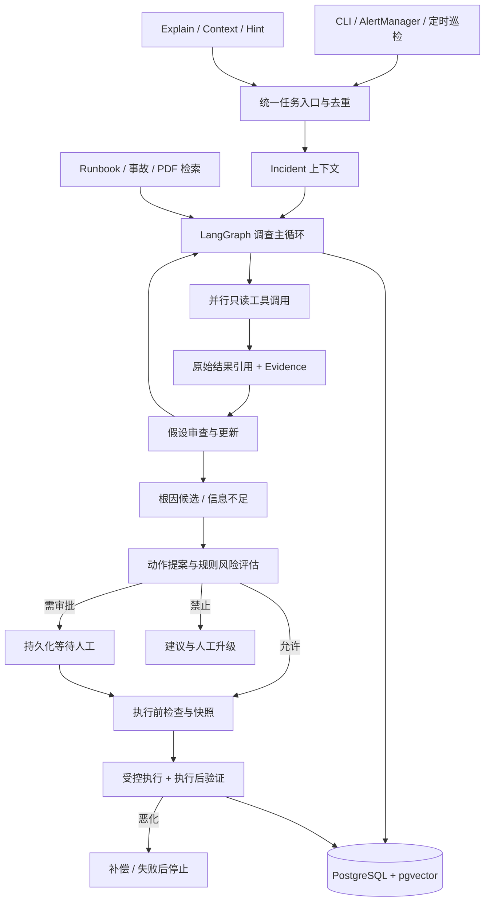

# Vigil AIOps 架构

状态：W0 决策基线；功能实现尚未开始。本文区分用户已选范围与待验证的实现建议。

## 产品目标

提供事件驱动的故障调查、风险分级处置、执行后验证和有边界的自动补偿；CLI、外部 Agent 的 skill 与后台触发共享同一业务入口。面试作品必须提供可复现证据，而非用功能清单替代效果验证。

对话中“L5”表示本项目的受控自动处置目标，不代表行业认证或全场景自治。AIOps 不要求必须使用 Agent、假设树或自动写操作。通用 Harness 也能接入触发器、记忆、策略与 eval；本项目须用集成体验、恢复能力和评估证明专用服务的收益，不能以“skill 做不到”作为依据。

## 用户已确认的范围

| 领域 | 决定 |
|---|---|
| 迁移 | 旧代码、锁文件、配置及 Windows 脚本整体进入 `deprecated/`；新项目独立，不原地重构 |
| 平台 | Linux、shell/Python、uv；优先成熟轻量依赖，避免自建通用运行时 |
| 环境 | k3d 单集群；选定 Online Boutique 的 frontend、checkout、cart、productcatalog、redis 五组件，依赖闭包待验证 |
| 遥测 | Prometheus + AlertManager + Loki + Tempo；配套采集器按实际接入需要配置 |
| 故障 | 四类共 12 场景；Python 注入脚本含 inject/verify/cleanup；首个切片为 OOM |
| 框架 | LangGraph 已明确选择；未确认替换为纯 Python 调查 runner |
| 调查 | 显式假设树、结构化证据、可审计验证；固定主循环中由模型决定查询方向 |
| 工具 | Python client / HTTP 直连 Prometheus、Loki、Tempo、Kubernetes；MCP 不进入关键路径 |
| 存储 | 一个 PostgreSQL + pgvector 实例承载关系数据、知识向量与官方 checkpoint 表 |
| 知识 | 结构化 runbook、历史事故记录、文本型 PDF 的最小导入管道 |
| 处置 | restart_pod、scale_replicas、rollout_undo；不执行代码/数据/任意配置修改 |
| 风险 | 规则为主，自动/审批/禁止三级；eval 的自动批准也受白名单与硬限制约束 |
| 恢复 | 动作前快照、执行后观察、恶化时补偿；补偿失败停止并升级人工 |
| eval | 规则评定位与恢复，LLM judge 辅助报告评审，人工抽检校准 |
| 并行 | 首版单 Agent + 并行工具；多 Agent 是后续增量，无独立模型 investigator |
| 对话 | 调查后带引用追问、审批交互、调查前 context、调查中 hint |
| 触发 | AlertManager webhook、CLI 手动、定时巡检 |
| 节奏 | 完整范围不缩减，垂直切片优先，阶段验收；时间按实际进度修订 |

## 分层

图中的边表达职责。具体节点拆分、checkpoint 粒度、任务领取机制仍需在 W1 切片中验证。checkpoint 保存工作流进度，不是 Kubernetes 快照，也不撤销外部副作用。

调查内部：提出候选 → 查询证据 → 审查支持/反证 → 更新、展开或终止。固定循环不意味着固定查询步骤；模型仍能按观察调整服务、时间窗和查询。预算是安全上限，不应替代证据充分性的判断。深度优先、排序权重、40 次工具/5 分钟等之前的数值未获确认，不视为验收要求。

## 可实现性边界

1. “三类独立信号”保留为默认的验证目标，不是通用充分条件。日志/指标/trace 可能同源相关，来源数量不能证明因果。缺少第三类信号时应标记证据缺口，不能编造；规则应按故障类型校准。
2. OOMKilled 通常应读取容器终止状态；不能保证存在同名 Kubernetes Event、应用日志或失败 span。持续 OOM 往往需要修复内存压力，重启不能保证解决。
3. restart_pod 是不可逆删除加控制器重建，不具备恢复原 Pod UID/内存/请求的 undo。对它要声明 `non_reversible`，只考虑无状态工作负载和可用性前置条件；无法为所有动作统一承诺可逆。
4. scale 可恢复原副本数，但不能恢复已丢失的内存与请求；需要检测 HPA/并发变更。rollout 的补偿要保存资源模板与前置版本，不能依赖“再次回滚到旧 revision”一定可用。
5. server dry-run 仅校验 API 请求和准入，不能预测调度、业务健康或实际副作用。Pod 删除的 dry-run 也不等于重启演练。
6. 手工 hint 仅追加可溯源上下文；只读 explain 不更新根因。运行中的提示在安全检查点消费，写入已审批动作参数需重新提案和评估。
7. 单机故障实验不证明生产可用、高可用、企业权限治理或总体准确率；不对任意故障保证自愈。

## 存储选择的依据

选择 pgvector 的主要理由是本项目已有关系状态与 checkpoint 需求，复用一套事务、备份和连接管理。Chroma server、Qdrant 同样可以支持共享检索；不能以 Chroma embedded 的并发限制排除其 server 模式。pgvector 的 ANN 加过滤可能召回不足，iterative scan、索引/分区与精确扫描需按样本验证；没有通用的十万/百万切换阈值。

权限过滤需要身份与授权实现，SQL 或 payload filter 本身不是授权。首版可以验证服务/文档范围过滤，不能据此声称企业 ACL 已落地。中文 PDF 的关键词检索也不能假定 PG 默认全文检索已支持良好的中文分词。

## 待验证，不阻断 W0

- 五服务应用的实际依赖、负载发生器与遥测埋点；需要补依赖时记录差异并让用户审阅。
- 12 个故障的具体注入法、可接受诊断/缓解集合；不要求 12 个都能用三类动作修好。
- 调查预算、最大并发、信号充分性、风险规则阈值、观察窗口；先以可配置实现草案验证，再确认默认值。
- 模型与 embedding 集成及其结构化输出行为；不自动继承旧 `.env`。
- 常驻进程的任务领取和重启恢复；不得因一次 CLI 已运行就声称 always-on 完成。

## 参考边界

- [LangGraph 持久化](https://docs.langchain.com/oss/python/langgraph/persistence)：恢复图状态，外部动作仍需幂等。
- [HolmesGPT](https://github.com/HolmesGPT/holmesgpt)：工具循环、CLI/后台入口参考，不等于本项目已采用其实现。
- [pgvector](https://github.com/pgvector/pgvector)：过滤与索引行为以所锁版本和实测为准。
- [Kubernetes Deployment](https://kubernetes.io/docs/concepts/workloads/controllers/deployment/)：回滚对象和历史语义。
